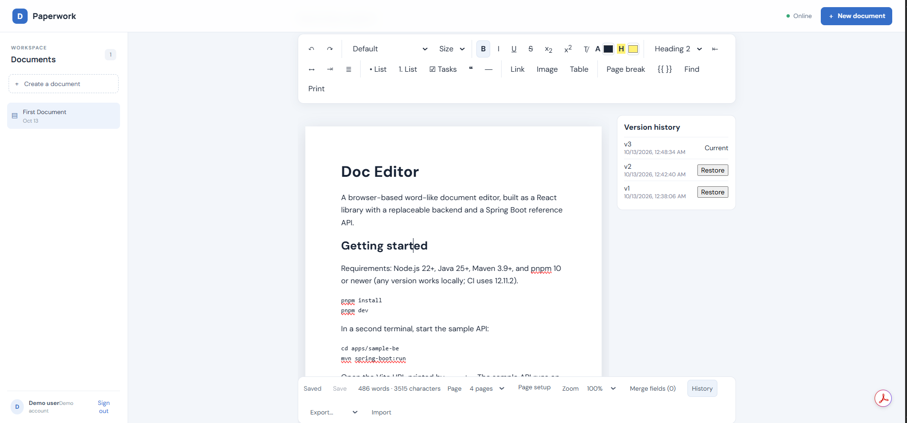

# Doc Editor

A browser-based word-like document editor, built as a React library with a replaceable backend and a Spring Boot reference API.



*The Paperwork sample app: edit rich-text documents, adjust page settings, and browse or restore saved versions.*

## Getting started

Requirements: Node.js 22+, Java 25+, Maven 3.9+, and pnpm 10 or newer (any version works locally; CI uses 12.11.2).

```sh
pnpm install
pnpm dev
```

In a second terminal, start the sample API:

```sh
cd apps/sample-be
mvn spring-boot:run
```

Open the Vite URL printed by `pnpm dev`. The sample API runs on `http://localhost:8080`; the frontend proxies `/api` requests to it.

## Workspace

- `packages/editor`: typed React editor library, backend contract, fetch adapter, page-break extension, and merge-field utilities.
- `apps/sample-fe`: Vite + React demo with sign-in, document management, explicit save, Fill & Print and export.
- `apps/sample-be`: Spring Boot + H2 reference REST API with optimistic concurrency, version history and server export.

The editor library depends on the `DocumentBackend` interface, not the sample API. Supply your own implementation to connect another service.

## Usage

```tsx
import { DocEditor, FetchBackend } from '@talaatharb/doc-editor';
import '@talaatharb/doc-editor/style.css';

const backend = new FetchBackend({ baseUrl: '' });

<DocEditor backend={backend} documentId={id} autoPagination onSaved={(version) => refreshList()} />;
```

| Prop | Purpose |
| --- | --- |
| `backend`, `documentId` | Required. Any `DocumentBackend` implementation. |
| `mode`, `mergeData`, `mergeFallback` | `'preview'` shows the template with merge data applied (read-only, never saved). |
| `autosave` | Save after each pause in typing instead of on Save / Ctrl+S. |
| `autoPagination` | Experimental automatic page boundaries. |
| `onTitleChange`, `onMergeKeysChange`, `onSaved` | Change notifications. |
| `editorRef` | Exposes the underlying Tiptap `Editor`. |

If the editor sits below a fixed header, set the CSS variable `--editor-sticky-offset` to the header height so the sticky toolbar stays visible.

## Features

- **Formatting**: bold/italic/underline/strike, sub/superscript, clear formatting, font family & size, text/highlight colour, paragraph styles (Normal, Heading 1–6), alignment, bullet/numbered/task lists with indent/outdent, quotes, links, horizontal rules, tables (with row/column/merge controls) and images (upload, paste, drop).
- **Shortcuts**: Ctrl+B/I/U, Ctrl+K link, Ctrl+Enter page break, Ctrl+Shift+M merge field, Ctrl+F find, Ctrl+S save, Ctrl+Space clear formatting, Ctrl+Alt+0 normal text, Tab/Shift+Tab list indent.
- **Pages**: paper size, orientation and margins (Page setup), explicit page breaks, page count / go-to-page, zoom, print CSS.
- **Merge fields**: inline `{{key}}` nodes (Ctrl+Shift+M), highlight toggle, keys panel, and a read-only preview with merge data (`mode="preview"` + `mergeData`). The sample app shows this as "Fill & Print".
- **Find & replace** (Ctrl+F) with match-case and regex, plus word/character count.
- **Import / export**: export to HTML, text or JSON; import `.html` (sanitised with DOMPurify), `.txt` or `.json`.
- **Persistence**: explicit save (Save button / Ctrl+S; `autosave` prop opts into debounced autosave), unsaved edits are kept as a local draft, with optimistic concurrency and a version history panel (when the backend implements `listVersions`/`restoreVersion`).
- **Headers & footers**: set in Page setup with `{page}`/`{pages}` tokens. Printing uses CSS `@page` margin boxes (per-page numbers; Chrome 131+ recommended).
- **Automatic pagination (experimental)**: `autoPagination` prop draws page boundaries from content height and feeds the page count and go-to-page. Content is not physically split in the editor; print splits naturally.
- **Offline & conflicts**: when a save fails because the network is down, the draft stays in `localStorage` and is retried when back online; a 409 shows a banner to keep your version or load the server's. Errors are recognised by `ConflictError`/`NetworkError` names, so custom backends can opt in.
- **Server export**: optional `exportDocument(id, format)` on the backend; the sample API serves `GET /api/documents/{id}/export?format=html|txt|json|pdf` (PDF is text-only, no images/inline styling).

Not yet implemented: DOCX import/export, physical content splitting across pages, line height / paragraph spacing controls, true multi-operation offline queue, Playwright E2E tests, Storybook.

## Commands

```sh
pnpm dev                 # frontend
pnpm build               # build all frontend workspaces
pnpm test                # editor unit tests
pnpm lint                # ESLint
pnpm format              # Prettier (write); CI runs pnpm format:check
cd apps/sample-be && mvn test
```

Demo sign-in: any non-blank username with password `demo`. Documents are stored as ProseMirror JSON with versioned metadata; HTML is never used in the persistence contract. H2 uses a local file by default. The sample token endpoint and static bearer token are for local demonstration only, not production authentication.
